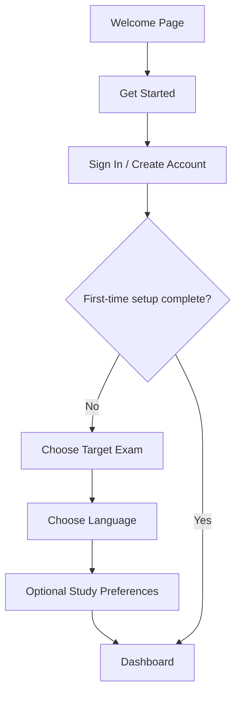
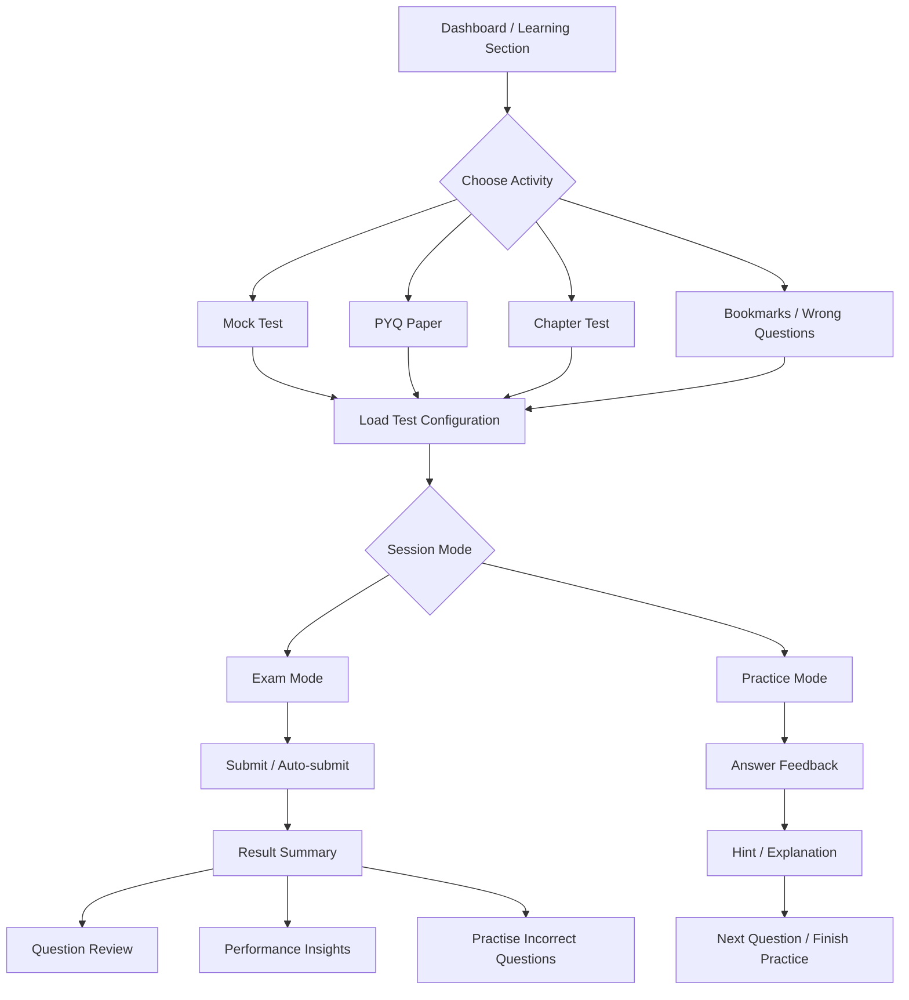
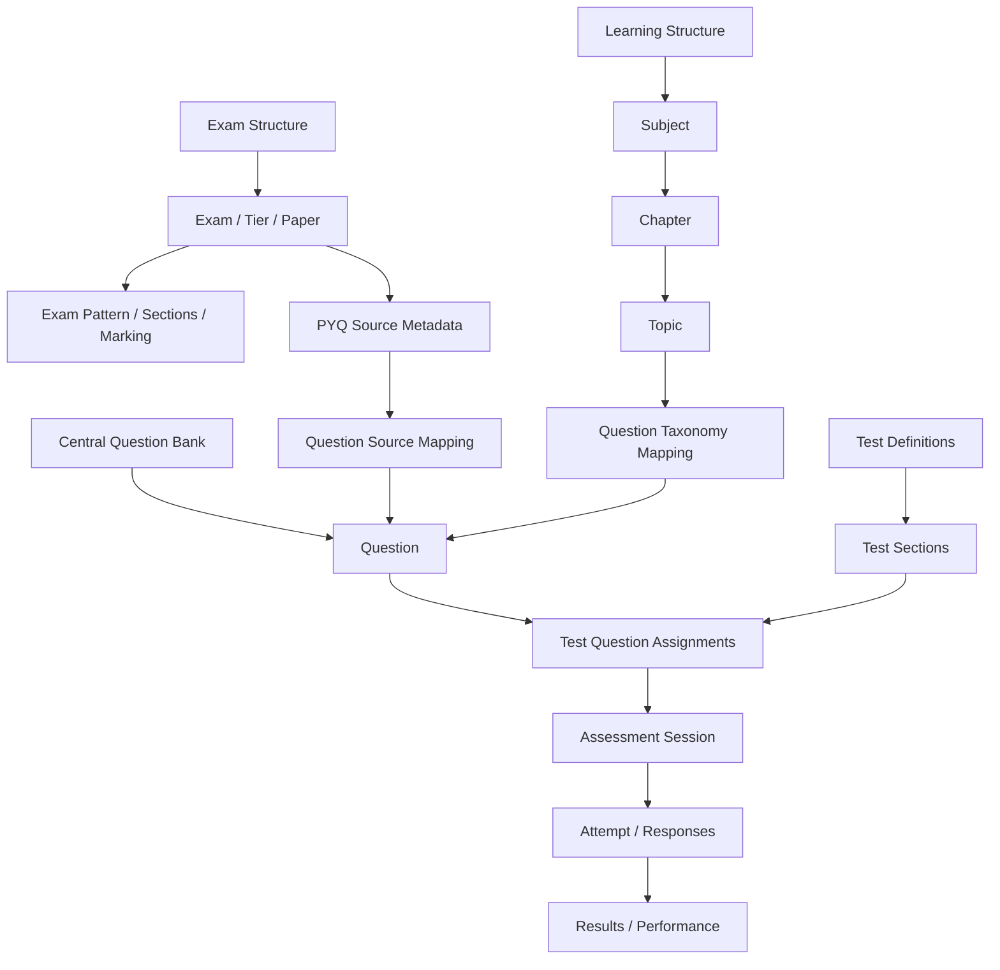

# SSC Flix — Refined Website Architecture

**Purpose:** A practical reference for the student-facing website, learning flows, content model, assessment system, student data and admin CMS.

This architecture consolidates the supplied student journey diagram, content-system diagram and previous website tree. It is a proposed product architecture, not a claim that every module is already implemented.

---

## 1. Architecture principles

1. **One canonical question bank.** A question is created once and reused in mock tests, PYQs, chapter practice, bookmarks and wrong-question practice.
2. **One assessment foundation.** Different learning activities create a session using shared question rendering, response saving, navigation and evaluation services.
3. **Two user experiences.** Exam Mode and Practice Mode are configurations of the shared assessment foundation, not two unrelated products.
4. **One attempt history.** Results, reviews and performance insights are generated from the same attempt and response records.
5. **Separate content from presentation.** Exam taxonomy, subject taxonomy, questions and test definitions are managed independently of the pages that display them.
6. **Simple student navigation.** The main navigation prioritises the four core activities: Dashboard, Mock Tests, PYQs and Chapter Tests.
7. **Admin is a separate workspace.** Students never see content-management tools in their normal navigation.
8. **Configurable exam rules.** Duration, sections, marks, negative marking and instructions come from exam/test configuration, not hardcoded page logic.

## 2. Complete website tree

```text
SSC FLIX
│
├── 01. PUBLIC WEBSITE
│   │
│   ├── Welcome Page
│   │   ├── Header
│   │   │   ├── SSC Flix Logo
│   │   │   ├── Sign In
│   │   │   └── Get Started
│   │   ├── Hero / Introduction
│   │   ├── Learning Approach
│   │   │   ├── Practise
│   │   │   ├── Understand
│   │   │   └── Improve
│   │   ├── Core Study Tools
│   │   │   ├── Mock Tests
│   │   │   ├── Previous Year Questions
│   │   │   └── Chapter Tests
│   │   ├── How It Works
│   │   ├── Final Get Started CTA
│   │   └── Footer
│   │       ├── About
│   │       ├── Contact / Support
│   │       ├── FAQs
│   │       ├── Privacy Policy
│   │       ├── Terms & Conditions
│   │       └── Disclaimer
│   │
│   ├── Informational Pages
│   │   ├── About SSC Flix
│   │   ├── Contact / Support
│   │   └── FAQs
│   │
│   └── Authentication
│       ├── Sign In
│       │   ├── Email
│       │   ├── Password
│       │   ├── Remember Me (optional)
│       │   └── Forgot Password
│       ├── Create Account
│       │   ├── Full Name
│       │   ├── Email
│       │   ├── Password
│       │   └── State (optional, if required)
│       ├── Email Verification (if enabled)
│       ├── Password Reset
│       └── Sign Out
│
├── 02. FIRST-TIME ONBOARDING
│   │
│   ├── Onboarding Introduction
│   ├── Choose Target Exam
│   │   ├── SSC CGL
│   │   ├── SSC CHSL
│   │   ├── SSC CPO
│   │   ├── SSC MTS
│   │   ├── SSC GD
│   │   └── SSC Stenographer
│   ├── Choose Interface / Question Language
│   │   ├── English
│   │   └── Hindi
│   ├── Basic Study Preferences (optional)
│   ├── Review Preferences
│   └── Enter Dashboard
│
│   Note: Onboarding is shown to a new account or a user who has not completed setup.
│   Returning users go directly to the Dashboard. Preferences can be changed later.
│
├── 03. STUDENT LEARNING WORKSPACE
│   │
│   ├── A. DASHBOARD
│   │   ├── Welcome Header
│   │   │   ├── User Greeting
│   │   │   ├── Current Target Exam
│   │   │   └── Exam Countdown (optional)
│   │   ├── Continue Learning
│   │   │   ├── Resume In-progress Test / Practice (when available)
│   │   │   └── Recently Practised Chapter
│   │   ├── Quick Actions
│   │   │   ├── Start Mock Test
│   │   │   ├── Practise PYQs
│   │   │   └── Start Chapter Test
│   │   ├── Study Overview
│   │   │   ├── Tests Completed
│   │   │   ├── Questions Attempted
│   │   │   ├── Average Accuracy
│   │   │   └── Average Score (where applicable)
│   │   ├── Recent Activity
│   │   │   ├── Recent Test Attempts
│   │   │   ├── Recent Results
│   │   │   └── Recent Practice Sessions
│   │   ├── Performance Snapshot
│   │   │   ├── Score Trend
│   │   │   ├── Subject-wise Accuracy
│   │   │   └── Weak Areas
│   │   └── Recommended Next Action
│   │
│   ├── B. MOCK TESTS
│   │   ├── Mock Test Library
│   │   │   ├── All Tests
│   │   │   ├── Full-Length Tests
│   │   │   ├── Sectional Tests
│   │   │   ├── Attempted Tests
│   │   │   └── Premium Tests (only if subscription is implemented)
│   │   ├── Exam / Tier / Paper Filter
│   │   ├── Test List
│   │   ├── Test Details
│   │   │   ├── Test Name
│   │   │   ├── Target Exam / Tier
│   │   │   ├── Total Questions
│   │   │   ├── Maximum Marks
│   │   │   ├── Duration
│   │   │   ├── Sections
│   │   │   ├── Marking Scheme
│   │   │   └── Start Test
│   │   └── Launch → Shared Assessment System (Section 05)
│   │
│   ├── C. PREVIOUS YEAR QUESTIONS (PYQs)
│   │   ├── PYQ Library
│   │   ├── Exam Selection
│   │   ├── Tier / Paper Selection
│   │   ├── Year Selection
│   │   ├── Date / Shift Selection (where applicable)
│   │   ├── Subject Filter (optional)
│   │   ├── Paper Details
│   │   │   ├── Total Questions
│   │   │   ├── Duration
│   │   │   └── Exam Pattern
│   │   └── Choose Practice Type
│   │       ├── Full Paper → Exam Mode
│   │       └── Question-wise / Subject-wise → Practice Mode
│   │
│   ├── D. CHAPTER TESTS
│   │   ├── Subject Selection
│   │   │   ├── Quantitative Aptitude
│   │   │   ├── General Intelligence & Reasoning
│   │   │   ├── English Comprehension
│   │   │   ├── General Awareness
│   │   │   └── Computer Knowledge (where applicable)
│   │   ├── Chapter Selection
│   │   ├── Topic Selection (when available)
│   │   ├── Chapter Overview
│   │   │   ├── Total Available Questions
│   │   │   ├── Attempted Questions
│   │   │   ├── Accuracy / Progress
│   │   │   └── Start Practice
│   │   └── Launch → Practice Mode
│   │
│   ├── E. MY TESTS
│   │   ├── All Attempts
│   │   ├── In Progress
│   │   ├── Completed
│   │   ├── Expired / Interrupted (where applicable)
│   │   ├── Filter by Source
│   │   │   ├── Mock Test
│   │   │   ├── Sectional Test
│   │   │   ├── PYQ Paper
│   │   │   └── Chapter Test (if recorded as an attempt)
│   │   ├── Attempt Details
│   │   ├── Resume Attempt (only when permitted)
│   │   ├── View Result
│   │   ├── Review Answers
│   │   └── Reattempt (starts a new attempt)
│   │
│   ├── F. BOOKMARKS
│   │   ├── All Saved Questions
│   │   ├── Filter by Exam
│   │   ├── Filter by Subject / Chapter
│   │   ├── Filter by Source
│   │   │   ├── Mock Tests
│   │   │   ├── PYQs
│   │   │   └── Chapter Tests
│   │   ├── Open Question / Explanation
│   │   ├── Remove Bookmark
│   │   └── Practise Saved Questions → Practice Mode
│   │
│   ├── G. PREFERENCES & ACCOUNT
│   │   ├── Profile
│   │   │   ├── Personal Information
│   │   │   ├── Email
│   │   │   ├── Profile Photo (optional)
│   │   │   └── Edit Profile
│   │   ├── Target Exam
│   │   ├── Language Preferences
│   │   ├── Appearance
│   │   │   ├── Light Mode
│   │   │   └── Dark Mode
│   │   ├── Test Preferences
│   │   ├── Notifications
│   │   ├── Subscription (if enabled)
│   │   ├── Password / Security
│   │   └── Sign Out
│   │
│   └── H. OPTIONAL / FUTURE STUDENT FEATURES
│       └── Leaderboard
│           ├── Overall Ranking
│           ├── Weekly Ranking
│           └── Exam-wise Ranking
│
├── 04. CENTRALIZED RESULTS & PERFORMANCE
│   │
│   ├── Result Summary (per submitted attempt)
│   │   ├── Total Score / Maximum Marks
│   │   ├── Correct Answers
│   │   ├── Incorrect Answers
│   │   ├── Unattempted Questions
│   │   ├── Accuracy
│   │   └── Time Taken
│   │
│   ├── Section-wise Analysis (when sections exist)
│   ├── Question-wise Review
│   │   ├── All Questions
│   │   ├── Correct
│   │   ├── Incorrect
│   │   ├── Unattempted
│   │   ├── Your Answer
│   │   ├── Correct Answer
│   │   └── Explanation / Hint
│   │
│   ├── Performance Insights (across attempts)
│   │   ├── Score Progress
│   │   ├── Accuracy Progress
│   │   ├── Subject-wise Performance
│   │   ├── Chapter / Topic-wise Performance (where data is sufficient)
│   │   ├── Strong Areas
│   │   ├── Weak Areas
│   │   └── Time Management
│   │
│   └── Result Actions
│       ├── Review Answers
│       ├── Practise Incorrect Questions
│       ├── Bookmark Questions
│       ├── Reattempt Test
│       └── Return to Dashboard
│
├── 05. SHARED ASSESSMENT SYSTEM
│   │
│   ├── Session Launcher
│   │   ├── Receive Source (Mock / Sectional / PYQ / Chapter / Saved / Wrong)
│   │   ├── Load Questions and Test Configuration
│   │   ├── Select Session Mode
│   │   └── Create or Resume Attempt
│   │
│   ├── A. EXAM MODE
│   │   ├── Test Instructions
│   │   ├── Start Confirmation
│   │   ├── Test Header
│   │   │   ├── Test Name
│   │   │   ├── Countdown Timer
│   │   │   ├── Section Selector (when applicable)
│   │   │   └── Language Selector
│   │   ├── Question Display
│   │   │   ├── Question Number
│   │   │   ├── Question Text
│   │   │   ├── Question Image / Media
│   │   │   └── Answer Options
│   │   ├── Question Palette
│   │   │   ├── Not Visited
│   │   │   ├── Not Answered
│   │   │   ├── Answered
│   │   │   ├── Marked for Review
│   │   │   └── Answered & Marked for Review
│   │   ├── Question Navigation
│   │   │   ├── Previous
│   │   │   ├── Save & Next
│   │   │   ├── Clear Response
│   │   │   └── Mark for Review & Next
│   │   ├── Question Utilities
│   │   │   ├── Bookmark
│   │   │   └── Report Question
│   │   ├── Autosave Responses
│   │   ├── Submit Confirmation
│   │   ├── Automatic Submission on Timeout
│   │   └── Final Submission → Results
│   │
│   ├── B. PRACTICE MODE
│   │   ├── Practice Initialization
│   │   ├── Question Display
│   │   ├── Answer Selection
│   │   ├── Check Answer / Submit Answer
│   │   ├── Correct / Incorrect Feedback
│   │   ├── Hint (if available)
│   │   ├── Explanation
│   │   ├── Bookmark / Report Question
│   │   ├── Next Question
│   │   ├── Previous Question (where supported)
│   │   ├── Skip Question (where supported)
│   │   └── Finish Practice
│   │
│   └── C. SHARED SESSION SERVICES
│       ├── Question Renderer
│       ├── Language / Translation Loader
│       ├── Answer and Response Storage
│       ├── Question Navigation State
│       ├── Timer Service (Exam Mode / timed sessions)
│       ├── Bookmark Service
│       ├── Question Reporting Service
│       ├── Scoring and Evaluation
│       └── Attempt History
│
├── 06. CONTENT & QUESTION ARCHITECTURE
│   │
│   ├── A. EXAM HIERARCHY
│   │   └── Exam
│   │       └── Tier / Paper
│   │           ├── Exam Pattern
│   │           ├── Sections
│   │           ├── Duration
│   │           ├── Total Marks
│   │           ├── Marking Scheme
│   │           └── Year / Date / Shift (for PYQ source papers)
│   │
│   ├── B. LEARNING HIERARCHY
│   │   └── Subject
│   │       └── Chapter
│   │           └── Topic
│   │
│   ├── C. SUBJECT CATALOGUE
│   │   ├── Quantitative Aptitude
│   │   │   ├── Number System
│   │   │   ├── Simplification
│   │   │   ├── Percentage
│   │   │   ├── Ratio & Proportion
│   │   │   ├── Average
│   │   │   ├── Profit & Loss
│   │   │   ├── Discount
│   │   │   ├── Simple & Compound Interest
│   │   │   ├── Mixture & Alligation
│   │   │   ├── Time & Work
│   │   │   ├── Pipe & Cistern
│   │   │   ├── Time, Speed & Distance
│   │   │   ├── Boat & Stream
│   │   │   ├── Algebra
│   │   │   ├── Geometry
│   │   │   ├── Mensuration
│   │   │   ├── Trigonometry
│   │   │   └── Data Interpretation
│   │   ├── General Intelligence & Reasoning
│   │   │   ├── Analogy
│   │   │   ├── Classification
│   │   │   ├── Number Series
│   │   │   ├── Alphabet Series
│   │   │   ├── Coding-Decoding
│   │   │   ├── Blood Relations
│   │   │   ├── Direction & Distance
│   │   │   ├── Order & Ranking
│   │   │   ├── Syllogism
│   │   │   ├── Venn Diagrams
│   │   │   ├── Mathematical Operations
│   │   │   ├── Word Formation
│   │   │   └── Non-Verbal Reasoning
│   │   ├── English Comprehension
│   │   │   ├── Parts of Speech
│   │   │   ├── Tenses
│   │   │   ├── Subject-Verb Agreement
│   │   │   ├── Articles & Determiners
│   │   │   ├── Prepositions
│   │   │   ├── Error Detection
│   │   │   ├── Fill in the Blanks
│   │   │   ├── Sentence Improvement
│   │   │   ├── Synonyms & Antonyms
│   │   │   ├── One Word Substitution
│   │   │   ├── Idioms & Phrases
│   │   │   ├── Spelling Correction
│   │   │   ├── Cloze Test
│   │   │   └── Reading Comprehension
│   │   ├── General Awareness
│   │   │   ├── Ancient History
│   │   │   ├── Medieval History
│   │   │   ├── Modern History
│   │   │   ├── Indian Geography
│   │   │   ├── World Geography
│   │   │   ├── Indian Polity
│   │   │   ├── Economics
│   │   │   ├── Physics
│   │   │   ├── Chemistry
│   │   │   ├── Biology
│   │   │   ├── Static GK
│   │   │   └── Current Affairs
│   │   └── Computer Knowledge (where applicable)
│   │       ├── Computer Fundamentals
│   │       ├── Hardware & Software
│   │       ├── Memory & Storage
│   │       ├── Operating Systems
│   │       ├── MS Word
│   │       ├── MS Excel
│   │       ├── MS PowerPoint
│   │       ├── Internet & Networking
│   │       └── Cyber Security
│   │
│   ├── D. CENTRAL QUESTION BANK
│   │   └── Question
│   │       ├── Question Text
│   │       ├── Language Versions
│   │       ├── Question Image / Media
│   │       ├── Question Type
│   │       ├── Answer Options
│   │       ├── Correct Answer
│   │       ├── Explanation
│   │       ├── Hint
│   │       ├── Difficulty
│   │       ├── Subject / Chapter / Topic Mapping
│   │       ├── Exam Relevance / Tags
│   │       ├── Source Reference (if PYQ)
│   │       └── Publication Status
│   │
│   └── E. QUESTION SOURCES
│       ├── PYQ Source Paper
│       │   ├── Exam
│       │   ├── Tier / Paper
│       │   ├── Year
│       │   ├── Date
│       │   └── Shift
│       └── Other Source / Authoring Reference (optional)
│
├── 07. TEST CONTENT & CONFIGURATION
│   │
│   ├── Test Definition
│   │   ├── Test Type
│   │   │   ├── Full Mock
│   │   │   ├── Sectional Test
│   │   │   ├── PYQ Paper
│   │   │   └── Chapter Test
│   │   ├── Target Exam / Tier / Paper
│   │   ├── Instructions
│   │   ├── Duration
│   │   ├── Total Marks
│   │   ├── Marking Scheme
│   │   ├── Availability / Access Rules
│   │   └── Publication Status
│   ├── Test Sections
│   │   ├── Section Name
│   │   ├── Section Order
│   │   └── Section Rules (if applicable)
│   └── Question Assignments
│       ├── Test / Section Reference
│       ├── Question Reference
│       ├── Question Order
│       ├── Marks
│       └── Negative Marks
│
├── 08. STUDENT DATA & ACCOUNT SYSTEM
│   │
│   ├── User Profile
│   ├── User Preferences
│   │   ├── Target Exam
│   │   ├── Language
│   │   ├── Appearance
│   │   └── Test Preferences
│   ├── Test Attempts
│   ├── Attempt Question Snapshots
│   ├── User Responses
│   ├── Bookmarks
│   ├── Question Reports
│   ├── Notifications
│   └── Subscription / Entitlements (if enabled)
│
├── 09. GLOBAL UI & NAVIGATION
│   │
│   ├── Application Shell
│   │   ├── Desktop Sidebar
│   │   ├── Header
│   │   ├── Main Content Area
│   │   ├── Modal / Dialog Layer
│   │   └── Toast / Feedback Layer
│   ├── Header Controls
│   │   ├── Global Search
│   │   ├── Target Exam Switcher
│   │   ├── Notifications
│   │   └── Profile Menu
│   ├── Global Search
│   │   ├── Search Tests
│   │   ├── Search PYQ Papers
│   │   ├── Search Subjects / Chapters
│   │   └── Search Questions (if enabled)
│   ├── Mobile Bottom Navigation
│   │   ├── Dashboard
│   │   ├── Mock Tests
│   │   ├── PYQs
│   │   ├── Chapter Tests
│   │   └── More
│   │       ├── My Tests
│   │       ├── Bookmarks
│   │       ├── Preferences
│   │       └── Profile
│   └── Shared UI States
│       ├── Loading
│       ├── Empty States
│       ├── Error States
│       ├── Offline / Connection Warning (where relevant)
│       ├── Toast Messages
│       ├── Confirmation Dialogs
│       └── Access Restricted
│
├── 10. ADMIN & CONTENT MANAGEMENT SYSTEM
│   │
│   ├── Admin Authentication & Roles
│   ├── Admin Dashboard
│   │   ├── Content Overview
│   │   ├── Question Count / Status
│   │   ├── Test Overview
│   │   └── User / Attempt Overview
│   ├── Exam Management
│   │   ├── Exams
│   │   ├── Tiers / Papers
│   │   ├── Exam Patterns
│   │   ├── Sections
│   │   └── Marking Schemes
│   ├── Learning Structure Management
│   │   ├── Subjects
│   │   ├── Chapters
│   │   └── Topics
│   ├── Question Bank Management
│   │   ├── Create / Edit Question
│   │   ├── Archive Question
│   │   ├── Language Versions
│   │   ├── Question Options
│   │   ├── Correct Answer
│   │   ├── Explanation / Hint
│   │   ├── Difficulty / Tags
│   │   ├── Image / Media Upload
│   │   ├── PYQ Source Mapping
│   │   ├── Bulk Import / Export
│   │   ├── Duplicate Check
│   │   ├── Preview Question
│   │   └── Draft / Review / Published Status
│   ├── Test Management
│   │   ├── Create / Edit Test
│   │   ├── Configure Test Type
│   │   ├── Configure Duration / Marks
│   │   ├── Create Sections
│   │   ├── Assign Questions
│   │   ├── Set Question Order
│   │   ├── Configure Marking Scheme
│   │   ├── Preview Test
│   │   └── Publish / Unpublish
│   ├── User Management
│   │   ├── User Accounts
│   │   ├── User Activity
│   │   ├── Test Attempts
│   │   └── Subscription Status (if enabled)
│   ├── Content Moderation
│   │   ├── Reported Questions
│   │   ├── Content Corrections
│   │   └── User Feedback
│   └── System Administration
│       ├── Admin Roles / Permissions
│       ├── Site Settings
│       └── Audit Logs
```

---

## 3. Main student navigation

Keep the student-facing navigation intentionally small.

### Desktop sidebar

1. Dashboard
2. Mock Tests
3. PYQs
4. Chapter Tests
5. My Tests
6. Bookmarks
7. Preferences / Profile

Performance analysis should be available from the Dashboard and individual results. It does not need a permanent top-level sidebar item. Leaderboard can be considered later rather than competing with core study activities.

### Mobile bottom navigation

**Dashboard · Mock Tests · PYQs · Chapter Tests · More**

Place My Tests, Bookmarks, Preferences and Profile inside More. Keep the main exam and practice controls accessible without requiring a desktop layout.

---

## 4. Core user journeys

### A. New and returning users



### B. Assessment journey



### C. Content relationship



---

## 5. Recommended data model

The website tree describes pages and systems. The following entities describe the underlying data. Keep the content records separate from individual student activity.

| Entity | Responsibility |
|---|---|
| Users | Authentication identity and account ownership |
| User Profiles | Name and profile details |
| User Preferences | Target exam, language, appearance and test preferences |
| Exams | SSC exam categories |
| Exam Papers | Tier, paper and exam-level configuration |
| Exam Sections | Sections and their order within an exam or test |
| Subjects | Main learning subjects |
| Chapters | Chapters within subjects |
| Topics | Optional subtopics within chapters |
| Questions | Canonical question records |
| Question Translations | Language-specific question and explanation text |
| Question Options | Answer options and correct-answer mapping |
| Question Sources | PYQ year, date, shift and source-paper references |
| Question Assets | Images or other question media |
| Tests | Mock, sectional, PYQ and chapter-test definitions |
| Test Sections | Sections belonging to a test |
| Test Questions | Mapping of questions to tests, including order and marks |
| Test Attempts | Each student's individual session or attempt |
| Attempt Questions | Question snapshot and status for a particular attempt |
| User Responses | Selected answers and response state |
| Bookmarks | Questions saved by a student |
| Question Reports | Issues reported by students |
| Notifications | Student-facing notifications |
| Subscriptions | Plan and payment status, if subscriptions are enabled |
| Admin Roles | Admin permissions |
| Audit Logs | Important content and admin changes |

### Important relationships and data rules

- A question belongs to the central question bank and can be mapped to a subject, chapter, topic and one or more source papers.
- A PYQ paper is a source/context for questions; it is not a second question bank.
- A test references questions through a test-question assignment table. Avoid copying question content into every test definition.
- A student's response belongs to a particular attempt and attempt-question record.
- Store a snapshot of the question content, answer options and marking configuration used in an attempt. This protects historical results if an admin later edits a question or test.
- A bookmark references the canonical question and the user who saved it.
- Performance insights should be derived from attempts and responses. They should not become a separate, conflicting source of truth.
- Reattempting a test creates a new attempt; it should not overwrite the previous result.

---

## 6. Important system boundaries

| System | Owns | Should not own |
|---|---|---|
| Student pages | Navigation, filters, page layouts and user actions | Scoring rules or duplicated question content |
| Content system | Exams, subjects, chapters, topics and questions | Individual student responses |
| Test configuration | Test composition, sections, duration and marking rules | Student attempt history |
| Assessment system | Session state, question navigation, timers and response handling | Admin content authoring |
| Results system | Evaluation, answer review and performance summaries | A separate copy of question-bank content |
| Student data system | Profiles, preferences, bookmarks and attempts | Public content definitions |
| Admin CMS | Content creation, validation, publishing and moderation | Student-facing study navigation |

---

## 7. Important implementation rules

1. **One assessment foundation:** Mock tests, sectional tests, PYQ papers and chapter tests should use shared session and response logic.
2. **Two modes, shared foundation:** Exam Mode and Practice Mode may have different layouts and rules, but should reuse question rendering, answer storage and common question actions.
3. **One canonical question:** Do not create a separate copy of a question for every test or practice section.
4. **One attempt history:** All recorded attempts should appear in My Tests and feed the results system.
5. **Stable historical results:** Save attempt-time snapshots of questions and scoring configuration.
6. **Flexible taxonomy:** Subjects, chapters and topics should be manageable through the admin system rather than hardcoded into page components.
7. **Exam-aware configuration:** Question count, sections, duration and marking rules should be configurable per exam/test.
8. **Global question actions:** Bookmark and Report Question should work consistently wherever a question appears.
9. **Wrong-question practice is generated from responses:** It should reuse questions that a student answered incorrectly, not create duplicate question records.
10. **Responsive by design:** The Dashboard, test catalogue, question interface, palette and account pages must work on mobile and desktop.
11. **Admin stays separate:** Admin routes, permissions and navigation must be isolated from the student workspace.
12. **Optional features stay optional:** Subscription, leaderboard and other non-core features should not delay the core learning and assessment experience.

---

## 8. Recommended development order

| Phase | Scope | Main outcome |
|---|---|---|
| 1 | Authentication, onboarding, application shell and Dashboard | Students can enter and navigate the platform |
| 2 | Exam hierarchy, subject hierarchy and central question bank | Content can be organised and reused |
| 3 | Test definitions, sections and question assignments | Admins can assemble tests from shared questions |
| 4 | Shared assessment foundation and Exam Mode | Students can take mock, sectional and full-paper PYQ tests |
| 5 | Practice Mode and Chapter Tests | Students can practise questions with immediate feedback |
| 6 | Results, answer review and My Tests | Attempts can be evaluated and reviewed |
| 7 | Bookmarks, wrong-question practice and performance insights | Students can revise and identify weak areas |
| 8 | Profile, preferences, notifications and access controls | Core account experience is complete |
| 9 | Admin moderation, bulk tools and optional subscription / leaderboard | Operational and optional features are added |

---

## 9. Final product structure

SSC Flix should revolve around four core student activities:

- **Dashboard** — continue learning and understand progress.
- **Mock Tests** — simulate the actual examination.
- **PYQs** — practise questions from previous examinations.
- **Chapter Tests** — strengthen individual subjects, chapters and topics.

**My Tests, Bookmarks, Results and Performance Insights support these activities.** The question bank, test configuration and assessment foundation power them behind the scenes. The admin CMS manages that content without making the student-facing experience complicated.
